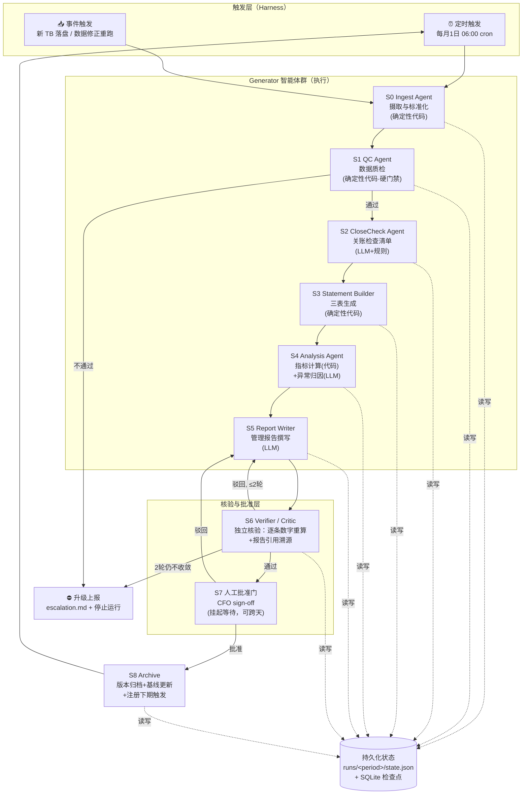

# 02 系统架构设计

## 2.1 带注释的工作流图

## 2.2 角色与交接

采用 **Orchestrator / Generator / Critic** 三类角色分工：

| 角色 | 职责 | 工具 | 输入产物 → 输出产物 |
|------|------|------|---------------------|
| **Orchestrator**（Harness/控制器，`src/core/orchestrator.py`） | 阶段调度与依赖解析；维护全局状态台账（run ID、期间、各阶段状态、输入哈希、产物路径、版本、决策记录）；把 Critic 的问题项打包成「修复任务包」路由回 Report Writer；执行重试与升级；**不自己做业务判断，不绕过人工批准** | 文件系统、SQLite、cron/文件监听 | 状态台账 state.json → 阶段调度指令 |
| **Ingest / QC Agent**（S0–S1） | TB 标准化与质检。全部为**确定性代码**（借贷平衡=0、未知科目、余额方向异常、必填字段），确定性计算的正确性不应交给 LLM 概率性判断 | pandas、科目映射表 | TB CSV → 标准化 TB + QC 报告 |
| **CloseCheck Agent**（S2） | 按关账检查清单逐项核对并解释（折旧是否计提、往来是否异常、应计是否遗漏线索）。规则能判的用规则，需要阅读与判断的用 LLM | QC 报告、TB、检查清单模板 | → 关账检查清单（含 LLM 提示项） |
| **Statement Builder**（S3） | 按映射表把 TB 汇总为三表。**纯确定性代码**，保证报表数字与 TB 可重算一致（验收标准 1） | 映射表、TB | → BS / IS 简表（CSV+Markdown） |
| **Analysis Agent**（S4） | 指标计算用**确定性代码**（毛利率、应收/存货环比、现金变动、OCF/NI 背离近似）；对超阈值项由 LLM 做**归因解读**并生成异常清单 | 指标引擎（代码）、阈值配置、LLM | → 指标表 + 异常清单 |
| **Report Writer**（S5） | 把异常清单与报表写成管理层月度报告；**每个数字必须标注来源**（TB 行/指标表行） | 报表、异常清单、报告模板、LLM | → 报告草稿 v1/v2/v3 |
| **Verifier / Critic**（S6） | **独立于 Writer**：只拿报告 + 原始数据 + 指标表，看不到 Writer 的推理过程；逐条重算报告数字、核对引用溯源、覆盖检查（异常清单是否全部入报告）；问题项标明 ID/严重级/证据/修复建议；数字错误、来源缺失等**强制阻塞** | 确定性重算代码、LLM | → 核验意见（PASS / 问题清单） |
| **人工批准门**（S7，Harness 执行） | 终稿发布前 CFO 人工 sign-off；架构只提出待批准事项，**最终批准权保留给人** | CLI 确认 / 批准文件标记 | → 批准记录 |

**为什么这样分工**：确定性计算（平衡、汇总、指标）与概率性生成（归因、行文）分离，使"数字正确"可由代码保证和测试；Writer 与 Verifier 分离避免生成方自我背书；Orchestrator 只管分派、状态与路由，业务判断下沉到各 Generator，最终放行权保留给人。

## 2.3 长程运行设计

**持久化状态与检查点**：每期运行目录 `runs/<period>/`，含 `state.json`（台账）与 SQLite 检查点。每个阶段完成时原子写入：阶段名、状态、输入哈希（输入文件的 SHA-256）、产物路径、时间戳、配置版本（git commit）。

**中断恢复**：启动时读取最新检查点；已完成且输入哈希未变的阶段**跳过**；输入哈希变化（如 TB 修正重传）→ 该阶段及其全部下游标记失效，仅重跑失效子图。恢复测试见 docs/03 验收清单第 4 条。

**触发机制**：① cron 每月 1 日 06:00；② `data/inbox/` 新文件事件；③ 手动 `python3 run.py --period <YYYY-MM> [--resume]`。

**重试与升级**：工具/LLM 调用失败按指数退避重试（1s/4s/16s，最多 3 次）；QC 硬门禁失败、修订 2 轮不收敛、重试耗尽、人工驳回后不收敛——均**停止运行**并写 `escalation.md`（含上下文与建议动作），等待人工处理。

**限额**：单 run 最长 30 分钟；LLM 调用总 token 上限（config 可配）；工具权限白名单——只读 `data/`、`archive/`，只写 `runs/<period>/`，禁止网络外发与凭据读取。

**防未来信息泄露**：数据访问层 `load_period(period_end)` 只返回 ≤ period_end 的行；泄露测试构造含未来期间的数据文件，断言任何 Agent 输入中不出现未来行。

## 2.4 核验与改进

- **独立核验**：见 S6；Verifier 与 Writer 不共享上下文，核验含确定性重算，不只靠 LLM 复查。
- **人工批准**：S7 为强制门，归档（S8）只在批准记录存在时执行。
- **有界修订循环**：Critic 驳回 → Orchestrator 组装修复任务包 → Writer 修订，最多 2 轮；仍不收敛 → 升级人工，禁止无限循环。
- **基线测试与采纳/拒绝**：`tests/test_golden.py` 固定样例数据的期望产物（平衡校验通过、4 个预埋异常全部检出）。任何提示词/代码改动先跑 golden 回归：通过才合并，不通过则拒绝并记录；决策写入 `CHANGELOG.md`。
- **版本与回滚**：每期归档记录配置与代码的 git commit；提示词纳入版本管理；回归失败或线上事故时 `git revert` 回滚，归档目录按 `<period>/v<n>/` 不可变保存，永不覆盖。
